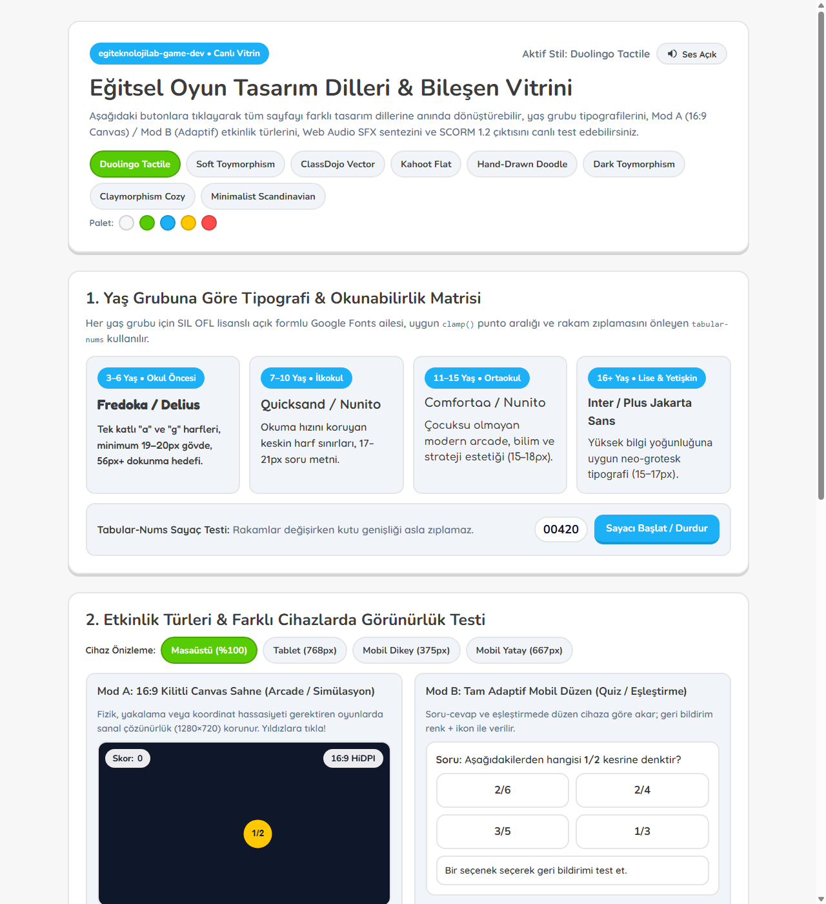
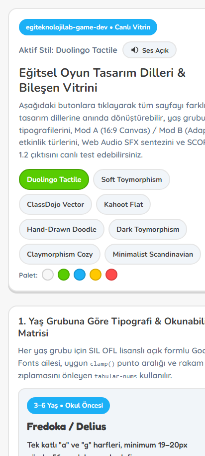

# egiteknolojilab-game-dev

**2D HTML5, Canvas ve Vanilla JavaScript** tabanlı etkileşimli eğitsel oyunlar, simülasyonlar, quiz/eşleştirme etkinlikleri ve **SCORM 1.2** uyumlu web içerikleri geliştirmek için hazırlanmış **ücretsiz ve açık kaynaklı (MIT)** Agent Skill paketi.

> **Canlı Örnek / Vitrin Sayfası:** Repo içindeki [`examples/showcase.html`](examples/showcase.html) dosyasını doğrudan tarayıcınızda açarak 8 farklı tasarım dilini, yaş grubu tipografilerini, Mod A (16:9 Canvas) & Mod B (Adaptif Quiz) etkinliklerini, cihaz önizleme modlarını (Masaüstü / Tablet / Mobil), ekli `.mp3` ses efektlerini + arka plan müziklerini ve SCORM 1.2 / `postMessage` çıktılarını canlı olarak test edebilirsiniz.

---

## Detaylı Önizlemeler

### Masaüstü / Akıllı Tahta Görünümü


### Mobil Responsive Görünüm


---

## Özellikler

- **Akıllı Hibrit İş Akışı (`SKILL.md`):** Konu/yaş grubu, yerleşim modu, tasarım dili ve çıktı formatını netleştirir; ardından 5 satırlık mini tasarım özeti (GDD-Lite) çıkarıp doğrudan üretime geçer.
- **12 Tasarım Dili & EdTech Renk Paleti:** *Duolingo Tactile*, *Soft Casual Toymorphism*, *Playful Vector (ClassDojo)*, *Geometric Flat (Kahoot)*, *Hand-Drawn Doodle*, *Dark Casual Toymorphism*, *Claymorphism Cozy*, *Minimalist Scandinavian*, *Casual Wooden*, *Modern Vibrant Flat*, *Tactile Cozy Puzzle*, *Fresh Hex-Grid*.
- **Yaş Grubuna Göre Tipografi Matrisi:** `3–6` (Okul Öncesi), `7–10` (İlkokul), `11–15` (Ortaokul) ve `16+` (Lise/Yetişkin) için SIL OFL lisanslı fontlar, `clamp()` ölçekleme, disleksi dostu kurallar ve `tabular-nums` sayaçlar.
- **İki Yerleşim Modu (`game-shell.css`):**
  - **Mod A (16:9 Kilitli Sahne):** Simülasyon, platformer ve arcade oyunlar için `1280×720` sanal çözünürlük ve HiDPI Canvas ölçekleme.
  - **Mod B (Tam Adaptif Mobil Düzen):** Quiz, eşleştirme ve sürükle-bırak etkinlikler için `100dvh` içinde akışkan grid ve `48px+` dokunma hedefleri.
- **Hazır Ses & BGM Kütüphanesi (`assets/sounds/`) + Zorunlu Mute Butonu:** `ui/`, `feedback/`, `sfx/` ve 4 adet arka plan müziği (`bgm/`). `audio-synth.js` gerçek `.mp3` dosyalarını oynatır, eksik efektlerde Web Audio sentezine düşer; her oyunun HUD barında zorunlu Ses Aç/Kapat butonu yer alır.
- **Sıfır Bağımlılıklı Çekirdek Modüller (`templates/`):** `engine.js`, `audio-synth.js`, `vfx.js`, `media-player.js`, `game-shell.css`, `scorm-api.js`, `imsmanifest.xml`.
- **Ultra Hafif Paketleme (`scripts/package_build.py`):** Web ZIP veya SCORM 1.2 ZIP çıktısı üretir.

---

## Yapay Zeka Araçlarına Kurulum (Adım Adım)

### 1. Antigravity
**Tüm projelerde geçerli (Global) kurulum:**
```bash
# macOS / Linux
git clone https://github.com/ozcansayid/egiteknoloji-game-dev-skill.git ~/.gemini/config/skills/egiteknolojilab-game-dev
```
```powershell
# Windows (PowerShell)
git clone https://github.com/ozcansayid/egiteknoloji-game-dev-skill.git "$env:USERPROFILE\.gemini\config\skills\egiteknolojilab-game-dev"
```

**Yalnızca tek bir proje klasörü için kurulum:**
```bash
git clone https://github.com/ozcansayid/egiteknoloji-game-dev-skill.git .agents/skills/egiteknolojilab-game-dev
```

---

### 2. Claude Code
**Tüm projelerde geçerli (Global) kurulum:**
```bash
# macOS / Linux
git clone https://github.com/ozcansayid/egiteknoloji-game-dev-skill.git ~/.claude/skills/egiteknolojilab-game-dev
```
```powershell
# Windows (PowerShell)
git clone https://github.com/ozcansayid/egiteknoloji-game-dev-skill.git "$env:USERPROFILE\.claude\skills\egiteknolojilab-game-dev"
```

**Proje bazlı kurulum:**
```bash
git clone https://github.com/ozcansayid/egiteknoloji-game-dev-skill.git .claude/skills/egiteknolojilab-game-dev
```

---

### 3. Cursor
Cursor'da proje kök dizinindeki `.cursor/skills/` (veya `.agents/skills/`) klasörüne yükleyebilirsiniz:
```bash
# macOS / Linux / Git Bash
git clone https://github.com/ozcansayid/egiteknoloji-game-dev-skill.git .cursor/skills/egiteknolojilab-game-dev
```
```powershell
# Windows (PowerShell)
git clone https://github.com/ozcansayid/egiteknoloji-game-dev-skill.git ".cursor\skills\egiteknolojilab-game-dev"
```
> İpucu: Cursor ayarlarından **Agent Skills** özelliğinin açık olduğundan emin olun; ardından sohbette `/egiteknolojilab-game-dev` veya doğal dille çağırabilirsiniz.

---

### 4. ChatGPT (Custom GPT veya Projects)
ChatGPT yerel dosya sistemine doğrudan skill bağlamadığı için şu iki yöntemden birini kullanabilirsiniz:
1. **ChatGPT Projects (Önerilen):**
   - Bu repoyu sağ üstteki **Code → Download ZIP** ile indirin ve klasörü açın.
   - ChatGPT'de yeni bir **Project** oluşturun.
   - `SKILL.md` ve `references/` klasöründeki `.md` dosyalarını Project'in **Files (Dosyalar)** bölümüne yükleyin.
   - Project **Instructions** alanına şunu yazın: *"Eğitsel 2D HTML5/JS oyun ve etkinlik üretirken yüklenen `SKILL.md` ve `references/` dosyalarındaki tüm kurallara uy."*
2. **Custom GPT:**
   - Yeni bir GPT oluşturup **Knowledge** kısmına `SKILL.md`, `references/*.md` ve `templates/` dosyalarını yükleyin; **Instructions** kısmına `SKILL.md` içeriğini yapıştırın.

---

## Örnek Kullanım İstemleri (Prompts)

Skill kurulduktan sonra yapay zeka aracınıza şu şekilde komut verebilirsiniz:
- `"egiteknolojilab-game-dev skillini kullanarak 4. sınıflar için kesirleri eşleştirme oyunu yap"`
- `"egiteknolojilab-game-dev ile 2. sınıflar için Duolingo Tactile tarzında çarpım tablosu yakalama oyunu oluştur, Mod A 16:9 olsun"`
- `"egiteknolojilab-game-dev skillini kullanarak 6. sınıflar için Minimalist Scandinavian tarzında bir SCORM 1.2 quiz paketi hazırla"`

---

## Klasör Yapısı

```text
egiteknolojilab-game-dev/
├── SKILL.md                          # Ana skill yönergeleri ve çalışma akışı
├── README.md                         # Kurulum, önizlemeler ve dokümantasyon
├── LICENSE                           # MIT Lisansı
├── docs/
│   └── previews/                     # Masaüstü & Mobil ekran görüntüleri
├── examples/
│   └── showcase.html                 # Canlı tasarım, tipografi, cihaz ve ses vitrini
├── assets/
│   └── sounds/                       # Hazır UI, Feedback, SFX ve BGM (.mp3) sesleri
├── references/
│   ├── 01-design-languages.md        # 12 tasarım dili ve hex renk paletleri
│   ├── 02-typography-and-age.md      # Yaş grubu tipografi matrisi ve kurallar
│   ├── 03-layout-and-responsive.md   # Mod A (16:9) vs Mod B (Adaptif) kuralları
│   ├── 04-icons-media-and-audio.md   # Inline Material Rounded SVG, SFX/BGM ve player
│   ├── 05-game-dynamics-and-gamification.md # Oyun döngüsü, juice ve pedagojik geri bildirim
│   └── 06-scorm-and-export.md        # Küçük boyutlu paketleme, postMessage ve SCORM 1.2
├── templates/
│   ├── core/                         # engine.js, audio-synth.js, vfx.js, media-player.js
│   ├── layouts/                      # game-shell.css
│   └── scorm12/                      # imsmanifest.xml, scorm-api.js
└── scripts/
    └── package_build.py              # Web / SCORM 1.2 ZIP paketleyici
```

---

## Web ZIP ve SCORM 1.2 Paketleme

Geliştirdiğiniz oyun klasörünü yayınlamaya hazır hale getirmek için `scripts/package_build.py` betiğini kullanabilirsiniz:

```bash
# Standart küçük boyutlu Web ZIP çıktısı
python scripts/package_build.py --src ./oyun-klasoru --out ./dist/oyun-web.zip --mode web

# SCORM 1.2 uyumlu LMS ZIP çıktısı (imsmanifest.xml otomatik eklenir)
python scripts/package_build.py --src ./oyun-klasoru --out ./dist/oyun-scorm12.zip --mode scorm12 --title "Kesir Avcısı"
```

---

## Lisans

Bu proje **MIT Lisansı** altında ücretsiz ve açık kaynaklı olarak sunulmaktadır. Ticari, bireysel ve kamusal (MEB/EBA/SCORM) tüm eğitsel projelerde serbestçe kullanabilir, değiştirebilir ve dağıtabilirsiniz. Detaylar için [`LICENSE`](LICENSE) dosyasına bakın.

---

## Referanslar ve Geliştirici

- **Geliştirici:** Sayid Özcan — [LinkedIn](https://www.linkedin.com/in/ozcansayid/) | [sayidozcan.com](https://www.sayidozcan.com)
- **Platformlar:** [egiteknoloji.com](https://egiteknoloji.com) • [egiteknolojilab.com](https://egiteknolojilab.com)
